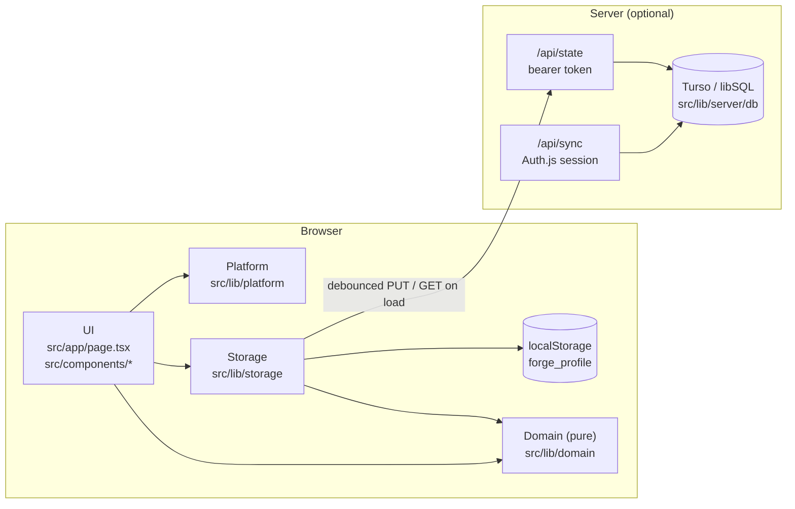

# Architecture

FORGE is a single Next.js 16 app. The product runs entirely in the browser:
the user profile lives in `localStorage`, every rule (quests, scores, streaks,
progression, morning ritual) is pure TypeScript, and the server is only an
optional backup target. This document describes the code as it is today.

## Layers

| Layer | Path | Responsibility | May import |
|---|---|---|---|
| Domain | `src/lib/domain` | Types, quest generation, scoring, progression, morning ritual, coach contract, analytics. Pure functions over `UserProfile`. | `uuid`, other domain modules |
| Storage | `src/lib/storage` | `profile-store.ts` reads/writes `localStorage` and runs `migrateProfile` on load. `state-sync.ts` pushes/pulls the whole profile to `/api/state`. | domain |
| Platform | `src/lib/platform` | Browser APIs: vibration, Notification API, service-worker registration. | nothing app-specific |
| Server | `src/lib/server`, `src/app/api` | Auth.js (Google), Drizzle schema and libSQL client, route handlers. | server only |
| UI | `src/app`, `src/components` | React 19 client components; `page.tsx` owns the `UserProfile` state and passes it down. | everything above |

The domain boundary is enforced, not just documented: `eslint.config.mjs`
rejects any import of storage, platform, server, React, Next or components
from `src/lib/domain/**`.

## Core data model

`UserProfile` (`src/lib/domain/types.ts`) is the single aggregate:

- `onboarding` — archetype, skills (current level and goal), "poisons", domains.
- `questTemplates` — what to generate each day (main / side / clean).
- `logs[YYYY-MM-DD]` — a `DayLog`: that day's concrete `Quest[]` plus computed scores.
- `morningLogs[YYYY-MM-DD]` — readiness check and ritual blocks.
- Derived counters: `totalXp`, `overallLevel`, `currentStreak`, `bestStreak`.

## Daily loop

1. **Generate.** `getTodayLog` (`domain/profile.ts`) creates today's log the
   first time it is read. Active templates become quests; skill-backed templates
   ask `computeTarget` (`domain/progression.ts`) for today's target.
2. **Progress.** `computeTarget` uses the skill's history: a damped increment
   toward the goal over ~12 weeks, scaled by last-7-day completion (x1.15 /
   x1 / x0.75 / x0.5), a 70% deload every fourth week, and an 85% volume drop
   when a plateau is detected (14+ entries, low completion).
3. **Score.** `computeDayScores` (`domain/scoring.ts`): day score =
   50% main + 15% side + 35% clean completion; XP = completed quest XP x
   (1 + 0.2 x clean ratio). Body / focus / recovery integrity come from clean
   quest categories.
4. **Aggregate.** `toggleQuest` recomputes total XP, level (`floor(xp/500)+1`)
   and the streak (consecutive days with score >= 50).
5. **Morning ritual.** `domain/morning.ts` turns a readiness check into a mode
   (`push`, `normal`, `grounded`, `minimum`, `recovery`) and a block list. A
   completed ritual (or quality >= 80%) injects one 100 XP main quest.
6. **Persist.** Every change goes through `saveAndSync` → `localStorage`
   immediately, then a 1.2 s debounced `PUT /api/state` if a sync token is set.

## Sync and backup

- **`/api/state` (used).** Whole-profile snapshot keyed by `FORGE_STATE_ID`,
  protected by a shared bearer token (`FORGE_SYNC_TOKEN`). On load the client
  pulls the snapshot and keeps the local copy if its timestamp is newer
  (last-writer-wins). Returns 503 when the database or token is not configured.
- **`/api/sync` (dormant).** Per-user relational sync behind an Auth.js Google
  session (`user_profiles`, `skills`, `quest_templates`, `day_logs`,
  `quest_entries`). The route exists but the current UI has no caller.

## Design decisions

- **Local-first.** No account, database or network is needed to use the app;
  the server is a backup, not the source of truth.
- **Pure domain.** All rules are deterministic functions of `UserProfile` and
  the clock, so they are unit-tested without a browser (`tests/domain`, Vitest
  with fake timers).
- **Soft deletes.** Removing a skill archives it and deactivates its templates
  so past logs still render.
- **Schema migration on read.** `migrateProfile` upgrades old stored profiles
  (missing templates, ids, skill fields) when they are loaded.

## Known limitations

- Dates are UTC (`toISOString().slice(0, 10)`), so "today" flips at UTC
  midnight rather than local midnight.
- `/api/state` stores a single profile per deployment and compares the bearer
  token with `===`; it is meant for a personal deployment, not multi-tenant use.
- Conflict resolution is whole-document last-writer-wins.
